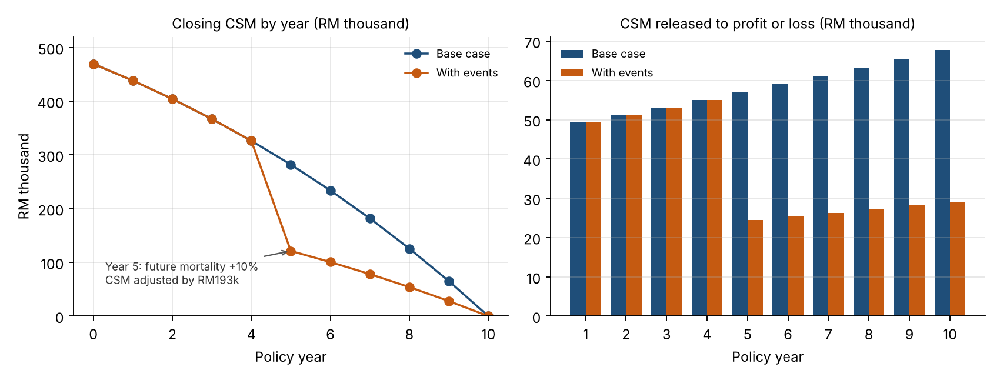

# IFRS 17 CSM Roll-Forward: 10-Year Term Life

An Excel and Python model that measures a single group of term life policies under IFRS 17 at initial recognition and rolls the contractual service margin (CSM) forward over the policy term. The mortality assumption comes from Malaysian open data (DOSM life tables). I built it to learn how the general measurement model works in practice, not to produce reportable numbers.



## What the model does

- Projects cash flows for 1,000 male lives aged 40 on a 10-year level term policy (sum assured RM100,000, annual premium in advance).
- Measures fulfilment cash flows (FCF) at initial recognition: PV of premiums, claims and expenses plus a risk adjustment. A net inflow becomes the CSM; a net outflow would be an onerous-group loss.
- Rolls the CSM forward each year: interest accreted at the locked-in rate, adjustment for changes in future-service estimates, and release using coverage units.
- Adds two events: extra deaths in year 3 (current service, through profit or loss) and a 10% rise in future mortality at the end of year 5 (future service, through the CSM).
- Runs sensitivities and stress scenarios with the contract premium held fixed.

## Headline results

| Item | Result |
|---|---|
| Premium per policy | RM428.34 per year (loading 1.20 on expected claims and expenses) |
| Fulfilment cash flows at day one | RM(469,523): a net inflow |
| Day-one CSM | RM469,523 (13.1% of PV of premiums), no day-one profit |
| Break-even premium loading | about 1.043 (below this the group is onerous) |
| Year-3 extra deaths (+2) | RM200,000 charged to profit or loss, CSM unchanged |
| Year-5 mortality +10% | FCF rises by RM193,233, CSM adjusted down by the same amount |
| Mortality buffer | with the premium fixed, mortality only needs to be about 17% above best estimate for the group to turn onerous |
| DOSM 2021 and 2022 rates (higher than 2024) | group is onerous at the base premium (day-one loss about RM214,000 to RM218,000) |

## Repository structure

```
README.md
requirements.txt
data/        DOSM extract, conversion notes and source (README_data.md)
model/       CSM_model.xlsx (Assumptions, Mortality, Cashflows, InitialRecognition,
             CSM_RollForward, Events, Sensitivities, Checks)
scripts/     csm_model.py, run_sensitivities.py, check_events.py, extract_mortality.py
results/     sensitivities.csv, two_way_csm.csv, rollforward_with_events.csv
docs/        write-up (PDF) and chart
```

## How to run

Excel: open `model/CSM_model.xlsx`. # compares Python with Excel (expect PASS)

Python (3.9 or newer):

```
python -m pip install -r requirements.txt
python scripts/csm_model.py          # base case
python scripts/check_events.py       # compares Python with the Excel results (expect PASS on every line)
python scripts/run_sensitivities.py  # writes results/*.csv
```

## Data

Mortality comes from the Department of Statistics Malaysia (DOSM), OpenDOSM, "Life Tables by State & Sex" (lifetables_state), licensed CC BY 4.0. I used Selangor, male, 2024 (the latest year DOSM treats as final), took the 40-44 and 45-49 five-year death probabilities, converted them to annual rates and smoothed them to single ages with a straight line through the logarithm of the rates at the band midpoints. Full details and the attribution are in `data/README_data.md`. Changes made: extraction of one state, sex, year and two age bands, conversion and smoothing.

Other inputs are my own assumptions: a flat 3.9% discount rate (based on the 10-year Malaysian Government Securities yield of about 3.86% in mid-November 2026), RM50 expense per policy per year, risk adjustment of 5% of the PV of claims, and a premium loading of 1.20.

## Validation

- Excel and Python agree on the premium, day-one CSM, the Event B adjustment and the closing CSM in every year (`scripts/check_events.py`).
- Six sensitivity scenarios were re-run in Excel and matched the Python results.
- The Checks sheet tests reconciliation, signs, timing and benchmark differences. The CSM closes at exactly nil in year 10.

## Limitations

- Population mortality, not insured-lives mortality, and a single state. State rates differ by roughly a factor of three at these ages.
- Abridged five-year bands smoothed to single ages, which is an assumption.
- One cohort, annual steps, no lapses, acquisition costs, reinsurance or yield curve. A flat discount rate stands in for the risk-free curve plus illiquidity premium that IFRS 17 normally calls for.
- Simplified risk adjustment (a percentage of PV of claims), held at the same percentage when re-measured.
- Extra deaths in Event A do not feed through to future lives or coverage units.
- Coverage units are undiscounted sum assured in force, a judgement allowed by the standard.
- Educational model. It is not suitable for financial reporting or pricing.

## Author

Nik Emran Shah bin Nik Edy Rozman, Actuarial Studies, Sunway University. linkedin.com/in/nikemranshah
